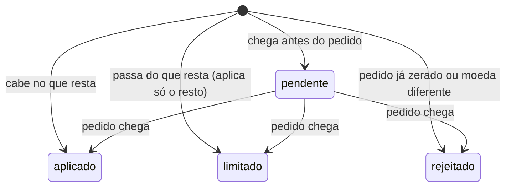

# Vendas atribuídas ao criador

Serviço que recebe webhooks de pedido e de estorno no formato essencial da Shopify, atribui cada venda a no máximo um criador (por cupom ou UTM) e reverte essa atribuição quando chega estorno, sem apagar nada do histórico.

Não conecta numa loja de verdade. Os webhooks são simulados com o mesmo formato, os mesmos headers (`X-Shopify-Webhook-Id`, `X-Shopify-Hmac-Sha256`) e a mesma assinatura HMAC.

## Como rodar

Precisa de Node 22 ou mais novo. Para a carga, também de Docker.

```bash
npm install
npm run seed        # cadastra os criadores de exemplo "ana" e "bruno" em data/vendas.sqlite
npm run dev         # sobe em http://127.0.0.1:3000 (PORT, DB_PATH e WEBHOOK_SECRET por variável de ambiente)
npm test            # unitários + integração (sqlite em memória, relógio fixo)
npm run typecheck
npm run load        # k6 via Docker na porta 3103 + verificação das invariantes
```

Sem `WEBHOOK_SECRET`, o servidor usa um segredo de desenvolvimento e avisa no log.

## Endpoints

| Método | Rota | O que faz |
| --- | --- | --- |
| POST | `/webhooks/shopify/orders` | webhook `orders/paid` |
| POST | `/webhooks/shopify/refunds` | webhook `refunds/create` |
| GET | `/orders/:id` | pedido com atribuição, estornos, líquido e log de entregas |
| GET | `/refunds/:id` | estorno (inclusive pendente) e suas entregas |
| GET | `/creators/summary` | bruto, estornado e líquido por criador e moeda, mais as vendas sem criador |
| POST | `/creators` | cadastra criador com `utmCampaign` e `coupons` |
| GET | `/creators/:id` | criador cadastrado |

Erros saem como `{ "error": { "code": "...", "message": "..." } }`: 400 para payload inválido, 401 para assinatura inválida, 404 e 409 (cupom ou UTM que já pertence a outro criador).

## Modelo de dados

Quatro tabelas em `src/db.ts`, onde fica todo o SQL:

- `creators` e `creator_coupons`: quem é dono de qual cupom e de qual `utm_campaign`. Os dois são únicos, então um cupom nunca pertence a dois criadores.
- `orders`: um registro por `order_id` (chave primária). A atribuição é gravada na chegada, com método, motivo e detalhe, e não muda mais.
- `refunds`: um registro por `refund_id` (chave primária), com o valor pedido e o valor aplicado.
- `webhook_deliveries`: log de cada entrega recebida, inclusive as repetidas.

Dinheiro é sempre inteiro em centavos. O `total_price` chega como string (`"199.90"`) e vira centavos por parsing da string (`src/money.ts`), sem passar por float. Número em vez de string é recusado com 400.

Estados de um estorno:



Saindo de `pendente`, o estorno não muda mais. A atribuição do pedido aparece como `ativa`, `parcialmente_revertida` ou `revertida`. Esse status é calculado do líquido, nada é sobrescrito.

## Regras e onde vivem

### Atribuição

A função `attribute`, em `src/attribution.ts`, é o único lugar que decide. A ordem é:

1. Cupom de criador. Se houver cupons de criadores diferentes, vence o primeiro na ordem em que a loja enviou (motivo `cupons_de_criadores_diferentes`).
2. UTM de criador: `utm_source=conty` e `utm_campaign` igual ao código UTM do criador. As UTMs são lidas do `landing_site`.
3. Nenhum dos dois: a venda é gravada sem criador (motivo `sem_criador`, com o que foi visto no detalhe).

Quando cupom e UTM apontam para criadores diferentes, o cupom vence (motivo `cupom_vence_utm`). Escolhi assim porque o comprador digita o cupom no checkout, perto da compra. A UTM vem do link de entrada, que pode ser de outra visita ou ter sido repassado. Cupom que não pertence a nenhum criador (ex.: `FRETEGRATIS`) é ignorado e a regra segue para a UTM. Exijo `utm_source=conty` para que uma campanha da própria marca cujo nome coincida com o código de um criador não seja atribuída a ele.

Testes: `test/unit/attribution.test.ts` e, pela API, `test/integration/orders.test.ts` ("desempate: cupom e UTM de criadores diferentes...", "cupom desconhecido cai para a UTM", "sem cupom nem UTM...").

### Estorno

A função `decideRefund`, em `src/refunds.ts`, recebe o total do pedido, o que já foi aplicado, o valor pedido e as moedas. Devolve `aplicado`, `limitado` ou `rejeitado`, com o valor aplicado e o motivo. A soma aplicada nunca passa do total, e o excedente fica registrado no próprio estorno (`requestedCents` maior que `appliedCents`, com `reason`). O valor de um estorno é a soma das transações `kind: "refund"` com `status: "success"`.

### Estorno antes do pedido

Em `src/sales.ts`, o estorno sem pedido é gravado como `pendente`. Quando o pedido chega, os pendentes daquele pedido são aplicados na mesma transação que insere o pedido, em ordem de `created_at`. Não existe janela em que o pedido está gravado e o estorno ainda não.

### Pedido não pago

Pedido com `financial_status` fora de `paid`, `partially_refunded` e `refunded` responde 200 com `"result": "ignorado"` e não grava venda (só o log da entrega). Respondo 200 para a loja não reenviar. O pedido entra quando chegar como pago.

### Histórico

Triggers no sqlite impedem apagar pedido ou estorno, alterar pedido, mexer num estorno já resolvido e passar do total do pedido. A regra mora no código, e os triggers seguram o caso de alguém ir direto no banco (há teste para isso).

## Exemplos reais

Saídas copiadas de uma execução local, com `npm run seed` e o servidor em `PORT=3103 WEBHOOK_SECRET=segredo-local`. Para assinar como a Shopify:

```bash
SECRET=segredo-local
URL=http://127.0.0.1:3103
send() { # $1 caminho, $2 webhook id, $3 corpo
  SIG=$(printf '%s' "$3" | openssl dgst -sha256 -hmac "$SECRET" -binary | base64)
  curl -s -w '\nHTTP %{http_code}\n' -X POST "$URL$1" \
    -H 'content-type: application/json' \
    -H "x-shopify-webhook-id: $2" \
    -H "x-shopify-hmac-sha256: $SIG" \
    -d "$3"
}
```

Estorno que chega antes do pedido fica pendente:

```bash
send /webhooks/shopify/refunds wh-r1 '{"id":7001,"order_id":5001,"created_at":"2026-03-05T10:00:00-03:00","transactions":[{"amount":"40.00","currency":"BRL","kind":"refund","status":"success"}]}'
```

```json
{"result":"criado","refund":{"refundId":"7001","orderId":"5001","status":"pendente","requestedCents":4000,"appliedCents":null,"reason":null,"currency":"BRL","createdAt":"2026-03-05T10:00:00-03:00","receivedAt":"2026-10-10T03:25:15.965Z","resolvedAt":null,"deliveries":[{"webhookId":"wh-r1","outcome":"criado","receivedAt":"2026-10-10T03:25:15.965Z"}]}}
HTTP 201
```

O pedido chega com cupom da Ana e UTM do Bruno. O cupom vence, e o estorno pendente é aplicado na mesma hora:

```bash
send /webhooks/shopify/orders wh-o1 '{"id":5001,"total_price":"199.90","currency":"BRL","financial_status":"paid","created_at":"2026-03-01T09:00:00-03:00","discount_codes":[{"code":"ANA10","amount":"19.99","type":"percentage"}],"landing_site":"/produtos/tenis?utm_source=conty&utm_campaign=bruno"}'
```

```json
{"result":"criado","order":{"orderId":"5001","totalCents":19990,"refundedCents":4000,"netCents":15990,"currency":"BRL","financialStatus":"paid","createdAt":"2026-03-01T09:00:00-03:00","receivedAt":"2026-10-10T03:25:15.990Z","discountCodes":["ANA10"],"utm":{"source":"conty","medium":null,"campaign":"bruno"},"attribution":{"creatorId":"ana","method":"cupom","reason":"cupom_vence_utm","detail":"cupom ana10 venceu a UTM bruno (bruno)","status":"parcialmente_revertida"},"refunds":[{"refundId":"7001","orderId":"5001","status":"aplicado","requestedCents":4000,"appliedCents":4000,"reason":null,"currency":"BRL","createdAt":"2026-03-05T10:00:00-03:00","receivedAt":"2026-10-10T03:25:15.965Z","resolvedAt":"2026-10-10T03:25:15.990Z"}],"deliveries":[{"webhookId":"wh-o1","outcome":"criado","receivedAt":"2026-10-10T03:25:15.990Z"}]}}
HTTP 201
```

O mesmo webhook de novo responde 200 com `"result":"duplicado"`, sem somar nada (os valores continuam `totalCents: 19990`, `refundedCents: 4000`). Só o log de entregas ganha uma linha `duplicado`.

Um estorno de R$ 180,00 passa do que resta (R$ 159,90) e é limitado:

```bash
send /webhooks/shopify/refunds wh-r2 '{"id":7002,"order_id":5001,"created_at":"2026-03-08T10:00:00-03:00","transactions":[{"amount":"180.00","currency":"BRL","kind":"refund","status":"success"}]}'
```

```json
{"result":"criado","refund":{"refundId":"7002","orderId":"5001","status":"limitado","requestedCents":18000,"appliedCents":15990,"reason":"pedido tinha 15990 centavos restantes; 2010 centavos pedidos a mais não foram aplicados","currency":"BRL","createdAt":"2026-03-08T10:00:00-03:00","receivedAt":"2026-10-10T03:25:16.030Z","resolvedAt":"2026-10-10T03:25:16.030Z","deliveries":[{"webhookId":"wh-r2","outcome":"criado","receivedAt":"2026-10-10T03:25:16.030Z"}]}}
HTTP 201
```

Agora `GET /orders/5001` mostra `"netCents":0` e a atribuição `"status":"revertida"`, com os dois estornos listados. O resumo:

```bash
curl -s $URL/creators/summary
```

```json
{"creators":[{"creatorId":"ana","creatorName":"Ana Souza","currency":"BRL","orders":1,"grossCents":19990,"refundedCents":19990,"netCents":0}],"unattributed":[]}
```

Assinatura errada:

```json
{"error":{"code":"INVALID_SIGNATURE","message":"assinatura X-Shopify-Hmac-Sha256 ausente ou inválida"}}
HTTP 401
```

## Idempotência e concorrência

- Pedido: `INSERT ... ON CONFLICT (order_id) DO NOTHING`. Se não inseriu, é repetição: responde 200 e não faz mais nada. A chave é o `order_id`, não o `X-Shopify-Webhook-Id`, porque o mesmo pedido pode chegar por entregas diferentes. A primeira versão vale. Uma repetição com outro total não sobrescreve (há teste).
- Estorno: o mesmo esquema com `refund_id`. Repetido antes ou depois do pedido, conta uma vez.
- Cada webhook roda numa transação `BEGIN IMMEDIATE` (`store.transaction` em `src/db.ts`), que lê o já aplicado, decide e grava sem ninguém escrever no meio.
- Testes com `Promise.all`: dez entregas iguais e simultâneas do mesmo pedido gravam um só; oito estornos de R$ 20 num pedido de R$ 100, cada um enviado três vezes ao mesmo tempo, terminam com R$ 100 aplicados; pedido e estornos misturados e repetidos chegam ao mesmo estado final.

## Por que essa solução

Um processo Node com sqlite serializa as escritas. Com uma instância só, a transação curta com restrição UNIQUE resolve duplicidade e corrida sem precisar de fila nem de lock. Não usei Redis porque a restrição do banco já garante que a mesma venda não entra duas vezes, e um lock externo seria mais uma peça para cair.

Com várias instâncias, eu trocaria o sqlite por Postgres e manteria a mesma ideia: `order_id` e `refund_id` únicos, `INSERT ... ON CONFLICT DO NOTHING` e `SELECT ... FOR UPDATE` na linha do pedido ao aplicar estorno, para dois estornos simultâneos não lerem o mesmo "já aplicado". Lock distribuído só valeria se houvesse efeito colateral fora do banco, como pagar o criador na hora, e mesmo assim eu começaria por uma tabela de outbox.

## Teste de carga

`npm run load` sobe a API na porta 3103 com banco temporário e roda `load/webhooks.js` no k6 (`grafana/k6:0.54.0`). A massa (`load/dataset.js`) tem 5 criadores, 600 pedidos em cinco formatos (só cupom, só UTM, cupom contra UTM, cupom desconhecido com UTM, sem nada) e 750 estornos (parciais, somando 90% e somando 130% do total). Cada evento é entregue 4 vezes em ordem embaralhada, e cada entrega sai em par simultâneo, então são 8 cópias de cada evento. No fim, `scripts/verify-load.ts` compara o resumo por criador com o esperado da massa e confere no banco que nenhum pedido tem estorno acima do total e que não sobrou estorno pendente. Se algo quebrar, sai com código 1.

Resultado de uma execução local (macOS, k6 em Docker):

```
✓ checks.........................: 100.00% 10800 out of 10800
✓ http_req_duration..............: avg=46.55ms min=937.42µs med=39.05ms max=1.74s p(90)=75.39ms p(95)=100.24ms
✓ http_req_failed................: 0.00%   0 out of 10805
  http_reqs......................: 10805   2037.603927/s

ok   criador-0: esperado {"orders":96,"grossCents":2396576,"refundedCents":1318654,"netCents":1077922} obtido {...igual}
...
ok   (sem criador): esperado {"orders":120,"grossCents":3115420,"refundedCents":1724990,"netCents":1390430} obtido {...igual}
pedidos gravados: 600 (esperado 600)
estornos gravados: 750 (esperado 750), pendentes no fim: 0
estornos que chegaram antes do pedido: 374
estornos limitados ou rejeitados por passar do total: 150
pedidos com estorno acima do total: 0
entregas recebidas: 10800, das quais duplicadas: 9450
VERIFICAÇÃO OK: invariantes mantidas
```

Thresholds: p95 abaixo de 500 ms, falhas abaixo de 1%, checks acima de 99,9%.

Para o k6 importar a massa compartilhada, monto a pasta `load/` no container (`-v load:/load`) em vez de passar o script pelo stdin.

## O que ficou de fora

- Atualizações de pedido (`orders/updated`, `orders/cancelled`). Cancelamento sem estorno não reverte a atribuição.
- Moedas com casas decimais diferentes de duas. O parser assume duas casas.
- Valor de estorno por item (`refund_line_items`). Uso só as transações.
- Autenticação no `POST /creators` e nas leituras.
- Fila: o webhook é processado na própria requisição, numa transação curta no sqlite.

## O que eu faria diferente com mais tempo

- Guardar o payload cru de cada entrega para reprocessar se a regra mudar.
- Um endpoint para listar estornos pendentes antigos (pedido que nunca chegou), com alerta.
- Janela de validade da UTM, quando a loja mandar dados de sessão.
- Paginação e filtro por período no resumo.

## Uso de IA

O código, os testes e este README foram produzidos com Claude Code (Claude Opus) a partir do enunciado do desafio. As decisões de modelagem (cupom vence UTM, estorno limitado com motivo, pendente aplicado na transação do pedido, triggers de histórico) foram propostas nesse processo.

**O que eu revisei** (rascunho para o autor confirmar): Revisei as regras de atribuição e de estorno e os testes que cobrem cada item do enunciado. Rodei `npm test`, `npm run typecheck` e `npm run load` localmente e conferi os exemplos de request e response contra o servidor rodando.
